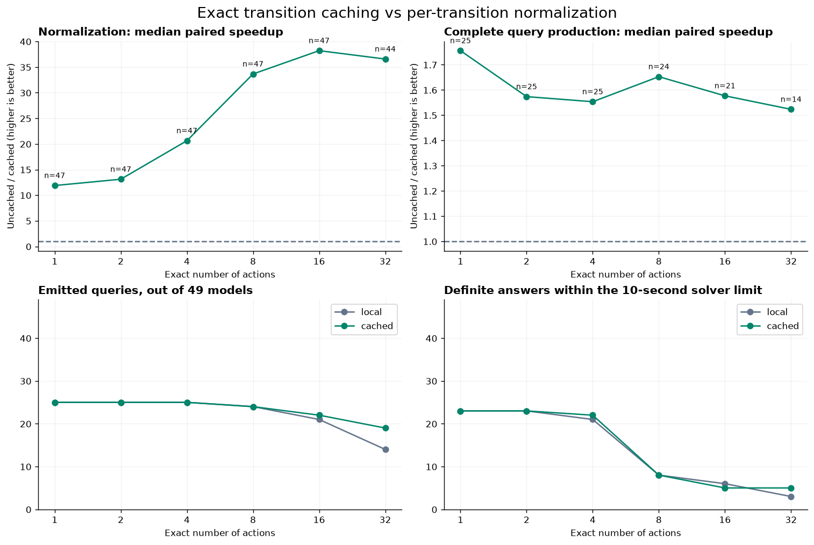

# Exact transition normalization cache

This experiment compares per-transition normalization with an opt-in cache of exact transition normal forms. It covers 49 model-bearing source files at exact depths 1, 2, 4, 8, 16 and 32: 588 primary cells.

The cache stores kernel-checked equality theorems for initialization, each named action and the complete tagged `any action` disjunction. Enable it before `#gen_spec`:

```lean
set_option veil.experimental.bmcCache true
```

It remains disabled by default because setup costs and solver search behavior can worsen.

| Measurement | Per-transition → cached |
| --- | --- |
| Median normalization speedup | 25.39× (279 completed pairs) |
| Median complete query-production speedup | 1.58× (134 completed pairs) |
| Including cold setup and VC elaboration | 1.03× (134 completed pairs) |
| Emitted SMT queries | 134 → 140 |
| Accepted by native cvc5 | 124 → 128 |
| Definite answers within 10 seconds | 84 → 86 |

Ratios use matched completed cases. Primary timings have one observation per cell; selected solver outcomes have separate repeat and 30-second controls. No failed run is counted as a completed timing.



Blockchain now emits an UNSAT query at depth 32, with solver times of 2.590, 2.926 and 2.979 seconds across three runs. At depth 16, however, cached solving regresses from roughly one second to 17.351 seconds in the longer control. Cold setup is also more expensive: the median addition is 0.355 seconds, and cached Raft exceeds the 60-second setup cap. The complete interpretation is in [RESULTS_ANALYSIS.txt](RESULTS_ANALYSIS.txt).

All 134 paired emitted formulas matched in the conservative logical audit; all 83 paired definite answers agree. The full regression build and seven focused tests with caching enabled passed. There are no simp step-limit failures in these query cells, but heartbeat, recursion and backend errors remain. The original issue's LamportMutexV1 reproducer is not part of this corpus.

- [Methods and limits](METHODS.txt)
- [Implementation and semantic guarantees](IMPLEMENTATION.txt)
- [Validation](VALIDATION.txt) and [machine-readable checks](validation.json)
- [Solver controls](SOLVER_BEHAVIOR.txt)
- [Remaining issues and proposed next fixes](NEXT_FIXES.txt)
- [Per-cell timings and outcomes](report/measurements.csv), [setup measurements](report/setup.csv), and [summary](report/summary.json)
- [Cold setup graph](report/setup-cost.png) and [remaining phase costs](report/phase-costs.png)

## Full evidence and previous comparisons

This PR includes the code, compact results, reproduction tools and all 49 model figures. The [complete investigation snapshot](https://github.com/verse-lab/veil/tree/e98a4b64f68359d94f2f118bc61651e197bc9d6f/Benchmarks/SMTTranslation) retains raw queries, logs, generated sources, controls, checksums and the previous early-introduction/local-normalization comparisons.

Download the [complete snapshot ZIP](https://github.com/verse-lab/veil/archive/e98a4b64f68359d94f2f118bc61651e197bc9d6f.zip) and open `Benchmarks/SMTTranslation/ActionCache/report/index.html` for the portable HTML report with all evidence links. The archived [cache report directory](https://github.com/verse-lab/veil/tree/e98a4b64f68359d94f2f118bc61651e197bc9d6f/Benchmarks/SMTTranslation/ActionCache) and [previous per-transition study](https://github.com/verse-lab/veil/tree/e98a4b64f68359d94f2f118bc61651e197bc9d6f/Benchmarks/SMTTranslation/TransitionLocal) are also browsable on GitHub. Their measurements are separate studies and must not be pooled.

## Reproduce

Build the worktree and its native cvc5 plugin using the repository setup instructions, then run from the repository root:

```sh
lake build Veil VeilTest
python3 Benchmarks/SMTTranslation/ActionCache/runner/run_batch.py --repo "$PWD" --out /tmp/veil-bmc-replay --manifest Benchmarks/SMTTranslation/ActionCache/manifest.json
python3 Benchmarks/SMTTranslation/ActionCache/runner/solve_batch.py --repo "$PWD" --out /tmp/veil-bmc-replay
python3 Benchmarks/SMTTranslation/ActionCache/runner/compare_local_queries.py --results /tmp/veil-bmc-replay --output /tmp/veil-bmc-replay/audit
```

Use a new output directory for a changed implementation: the runner deliberately resumes completed cells. `run.py` is a shared library; its retained predecessor standalone CLI is not the entry point for this experiment. The compact timing table retains the measured fields; verbose errors and full metadata remain in the snapshot. Vector figures link to that snapshot to keep the PR diff small. The full snapshot also includes rendering and packaging scripts tied to the original artifact layout. Recorded absolute paths identify the original run; they are provenance, not required checkout locations.

## Every model

Each figure contains normalization, complete query production, native solver replay and all failure outcomes. Missing points indicate failures, and solver timeouts are shown as censored observations. Exact-depth results need not be monotonic.

| Model | PNG | SVG |
| --- | --- | --- |
| `AWS_AWSBuggy` | [Figure](report/models/AWS_AWSBuggy.png) | [Vector](https://github.com/verse-lab/veil/blob/e98a4b64f68359d94f2f118bc61651e197bc9d6f/Benchmarks/SMTTranslation/ActionCache/report/models/AWS_AWSBuggy.svg) |
| `AWS_AWSFixed` | [Figure](report/models/AWS_AWSFixed.png) | [Vector](https://github.com/verse-lab/veil/blob/e98a4b64f68359d94f2f118bc61651e197bc9d6f/Benchmarks/SMTTranslation/ActionCache/report/models/AWS_AWSFixed.svg) |
| `Ivy_Blockchain` | [Figure](report/models/Ivy_Blockchain.png) | [Vector](https://github.com/verse-lab/veil/blob/e98a4b64f68359d94f2f118bc61651e197bc9d6f/Benchmarks/SMTTranslation/ActionCache/report/models/Ivy_Blockchain.svg) |
| `Ivy_ChordRingMaintenance` | [Figure](report/models/Ivy_ChordRingMaintenance.png) | [Vector](https://github.com/verse-lab/veil/blob/e98a4b64f68359d94f2f118bc61651e197bc9d6f/Benchmarks/SMTTranslation/ActionCache/report/models/Ivy_ChordRingMaintenance.svg) |
| `Ivy_DecentralizedLock` | [Figure](report/models/Ivy_DecentralizedLock.png) | [Vector](https://github.com/verse-lab/veil/blob/e98a4b64f68359d94f2f118bc61651e197bc9d6f/Benchmarks/SMTTranslation/ActionCache/report/models/Ivy_DecentralizedLock.svg) |
| `Ivy_MultiSigAll` | [Figure](report/models/Ivy_MultiSigAll.png) | [Vector](https://github.com/verse-lab/veil/blob/e98a4b64f68359d94f2f118bc61651e197bc9d6f/Benchmarks/SMTTranslation/ActionCache/report/models/Ivy_MultiSigAll.svg) |
| `Ivy_MultiSigMajority` | [Figure](report/models/Ivy_MultiSigMajority.png) | [Vector](https://github.com/verse-lab/veil/blob/e98a4b64f68359d94f2f118bc61651e197bc9d6f/Benchmarks/SMTTranslation/ActionCache/report/models/Ivy_MultiSigMajority.svg) |
| `Ivy_NOPaxos` | [Figure](report/models/Ivy_NOPaxos.png) | [Vector](https://github.com/verse-lab/veil/blob/e98a4b64f68359d94f2f118bc61651e197bc9d6f/Benchmarks/SMTTranslation/ActionCache/report/models/Ivy_NOPaxos.svg) |
| `Ivy_PaxosEPR` | [Figure](report/models/Ivy_PaxosEPR.png) | [Vector](https://github.com/verse-lab/veil/blob/e98a4b64f68359d94f2f118bc61651e197bc9d6f/Benchmarks/SMTTranslation/ActionCache/report/models/Ivy_PaxosEPR.svg) |
| `Ivy_PaxosFirstOrder` | [Figure](report/models/Ivy_PaxosFirstOrder.png) | [Vector](https://github.com/verse-lab/veil/blob/e98a4b64f68359d94f2f118bc61651e197bc9d6f/Benchmarks/SMTTranslation/ActionCache/report/models/Ivy_PaxosFirstOrder.svg) |
| `Ivy_ReliableBroadcast` | [Figure](report/models/Ivy_ReliableBroadcast.png) | [Vector](https://github.com/verse-lab/veil/blob/e98a4b64f68359d94f2f118bc61651e197bc9d6f/Benchmarks/SMTTranslation/ActionCache/report/models/Ivy_ReliableBroadcast.svg) |
| `Ivy_RicartAgrawala` | [Figure](report/models/Ivy_RicartAgrawala.png) | [Vector](https://github.com/verse-lab/veil/blob/e98a4b64f68359d94f2f118bc61651e197bc9d6f/Benchmarks/SMTTranslation/ActionCache/report/models/Ivy_RicartAgrawala.svg) |
| `Ivy_Ring` | [Figure](report/models/Ivy_Ring.png) | [Vector](https://github.com/verse-lab/veil/blob/e98a4b64f68359d94f2f118bc61651e197bc9d6f/Benchmarks/SMTTranslation/ActionCache/report/models/Ivy_Ring.svg) |
| `Ivy_SuzukiKasami` | [Figure](report/models/Ivy_SuzukiKasami.png) | [Vector](https://github.com/verse-lab/veil/blob/e98a4b64f68359d94f2f118bc61651e197bc9d6f/Benchmarks/SMTTranslation/ActionCache/report/models/Ivy_SuzukiKasami.svg) |
| `Ivy_TwoPhaseCommit` | [Figure](report/models/Ivy_TwoPhaseCommit.png) | [Vector](https://github.com/verse-lab/veil/blob/e98a4b64f68359d94f2f118bc61651e197bc9d6f/Benchmarks/SMTTranslation/ActionCache/report/models/Ivy_TwoPhaseCommit.svg) |
| `Ivy_VerticalPaxosFirstOrder` | [Figure](report/models/Ivy_VerticalPaxosFirstOrder.png) | [Vector](https://github.com/verse-lab/veil/blob/e98a4b64f68359d94f2f118bc61651e197bc9d6f/Benchmarks/SMTTranslation/ActionCache/report/models/Ivy_VerticalPaxosFirstOrder.svg) |
| `Puzzles_DieHard` | [Figure](report/models/Puzzles_DieHard.png) | [Vector](https://github.com/verse-lab/veil/blob/e98a4b64f68359d94f2f118bc61651e197bc9d6f/Benchmarks/SMTTranslation/ActionCache/report/models/Puzzles_DieHard.svg) |
| `Puzzles_Prisoners` | [Figure](report/models/Puzzles_Prisoners.png) | [Vector](https://github.com/verse-lab/veil/blob/e98a4b64f68359d94f2f118bc61651e197bc9d6f/Benchmarks/SMTTranslation/ActionCache/report/models/Puzzles_Prisoners.svg) |
| `Puzzles_RiverCrossing` | [Figure](report/models/Puzzles_RiverCrossing.png) | [Vector](https://github.com/verse-lab/veil/blob/e98a4b64f68359d94f2f118bc61651e197bc9d6f/Benchmarks/SMTTranslation/ActionCache/report/models/Puzzles_RiverCrossing.svg) |
| `Simulate_CheckpointLeaseFailover` | [Figure](report/models/Simulate_CheckpointLeaseFailover.png) | [Vector](https://github.com/verse-lab/veil/blob/e98a4b64f68359d94f2f118bc61651e197bc9d6f/Benchmarks/SMTTranslation/ActionCache/report/models/Simulate_CheckpointLeaseFailover.svg) |
| `Simulate_LeaseKeepaliveRace` | [Figure](report/models/Simulate_LeaseKeepaliveRace.png) | [Vector](https://github.com/verse-lab/veil/blob/e98a4b64f68359d94f2f118bc61651e197bc9d6f/Benchmarks/SMTTranslation/ActionCache/report/models/Simulate_LeaseKeepaliveRace.svg) |
| `Simulate_ReliableBroadcast` | [Figure](report/models/Simulate_ReliableBroadcast.png) | [Vector](https://github.com/verse-lab/veil/blob/e98a4b64f68359d94f2f118bc61651e197bc9d6f/Benchmarks/SMTTranslation/ActionCache/report/models/Simulate_ReliableBroadcast.svg) |
| `StellarConsensus_SCP` | [Figure](report/models/StellarConsensus_SCP.png) | [Vector](https://github.com/verse-lab/veil/blob/e98a4b64f68359d94f2f118bc61651e197bc9d6f/Benchmarks/SMTTranslation/ActionCache/report/models/StellarConsensus_SCP.svg) |
| `Synchronous_FasterFloodSet` | [Figure](report/models/Synchronous_FasterFloodSet.png) | [Vector](https://github.com/verse-lab/veil/blob/e98a4b64f68359d94f2f118bc61651e197bc9d6f/Benchmarks/SMTTranslation/ActionCache/report/models/Synchronous_FasterFloodSet.svg) |
| `Synchronous_FloodSet` | [Figure](report/models/Synchronous_FloodSet.png) | [Vector](https://github.com/verse-lab/veil/blob/e98a4b64f68359d94f2f118bc61651e197bc9d6f/Benchmarks/SMTTranslation/ActionCache/report/models/Synchronous_FloodSet.svg) |
| `TLA_AWSDnsRace` | [Figure](report/models/TLA_AWSDnsRace.png) | [Vector](https://github.com/verse-lab/veil/blob/e98a4b64f68359d94f2f118bc61651e197bc9d6f/Benchmarks/SMTTranslation/ActionCache/report/models/TLA_AWSDnsRace.svg) |
| `TLA_Bakery` | [Figure](report/models/TLA_Bakery.png) | [Vector](https://github.com/verse-lab/veil/blob/e98a4b64f68359d94f2f118bc61651e197bc9d6f/Benchmarks/SMTTranslation/ActionCache/report/models/TLA_Bakery.svg) |
| `TLA_BcastByz` | [Figure](report/models/TLA_BcastByz.png) | [Vector](https://github.com/verse-lab/veil/blob/e98a4b64f68359d94f2f118bc61651e197bc9d6f/Benchmarks/SMTTranslation/ActionCache/report/models/TLA_BcastByz.svg) |
| `TLA_BuggyCircularBuffer` | [Figure](report/models/TLA_BuggyCircularBuffer.png) | [Vector](https://github.com/verse-lab/veil/blob/e98a4b64f68359d94f2f118bc61651e197bc9d6f/Benchmarks/SMTTranslation/ActionCache/report/models/TLA_BuggyCircularBuffer.svg) |
| `TLA_EPaxos` | [Figure](report/models/TLA_EPaxos.png) | [Vector](https://github.com/verse-lab/veil/blob/e98a4b64f68359d94f2f118bc61651e197bc9d6f/Benchmarks/SMTTranslation/ActionCache/report/models/TLA_EPaxos.svg) |
| `TLA_EWD840` | [Figure](report/models/TLA_EWD840.png) | [Vector](https://github.com/verse-lab/veil/blob/e98a4b64f68359d94f2f118bc61651e197bc9d6f/Benchmarks/SMTTranslation/ActionCache/report/models/TLA_EWD840.svg) |
| `TLA_German` | [Figure](report/models/TLA_German.png) | [Vector](https://github.com/verse-lab/veil/blob/e98a4b64f68359d94f2f118bc61651e197bc9d6f/Benchmarks/SMTTranslation/ActionCache/report/models/TLA_German.svg) |
| `TLA_KVSnap` | [Figure](report/models/TLA_KVSnap.png) | [Vector](https://github.com/verse-lab/veil/blob/e98a4b64f68359d94f2f118bc61651e197bc9d6f/Benchmarks/SMTTranslation/ActionCache/report/models/TLA_KVSnap.svg) |
| `TLA_KeyValueStore` | [Figure](report/models/TLA_KeyValueStore.png) | [Vector](https://github.com/verse-lab/veil/blob/e98a4b64f68359d94f2f118bc61651e197bc9d6f/Benchmarks/SMTTranslation/ActionCache/report/models/TLA_KeyValueStore.svg) |
| `TLA_MultiPaxos` | [Figure](report/models/TLA_MultiPaxos.png) | [Vector](https://github.com/verse-lab/veil/blob/e98a4b64f68359d94f2f118bc61651e197bc9d6f/Benchmarks/SMTTranslation/ActionCache/report/models/TLA_MultiPaxos.svg) |
| `TLA_MutexViolation` | [Figure](report/models/TLA_MutexViolation.png) | [Vector](https://github.com/verse-lab/veil/blob/e98a4b64f68359d94f2f118bc61651e197bc9d6f/Benchmarks/SMTTranslation/ActionCache/report/models/TLA_MutexViolation.svg) |
| `TLA_NOPaxos` | [Figure](report/models/TLA_NOPaxos.png) | [Vector](https://github.com/verse-lab/veil/blob/e98a4b64f68359d94f2f118bc61651e197bc9d6f/Benchmarks/SMTTranslation/ActionCache/report/models/TLA_NOPaxos.svg) |
| `TLA_Paxos` | [Figure](report/models/TLA_Paxos.png) | [Vector](https://github.com/verse-lab/veil/blob/e98a4b64f68359d94f2f118bc61651e197bc9d6f/Benchmarks/SMTTranslation/ActionCache/report/models/TLA_Paxos.svg) |
| `TLA_Peterson` | [Figure](report/models/TLA_Peterson.png) | [Vector](https://github.com/verse-lab/veil/blob/e98a4b64f68359d94f2f118bc61651e197bc9d6f/Benchmarks/SMTTranslation/ActionCache/report/models/TLA_Peterson.svg) |
| `TLA_Raft` | [Figure](report/models/TLA_Raft.png) | [Vector](https://github.com/verse-lab/veil/blob/e98a4b64f68359d94f2f118bc61651e197bc9d6f/Benchmarks/SMTTranslation/ActionCache/report/models/TLA_Raft.svg) |
| `TLA_Room` | [Figure](report/models/TLA_Room.png) | [Vector](https://github.com/verse-lab/veil/blob/e98a4b64f68359d94f2f118bc61651e197bc9d6f/Benchmarks/SMTTranslation/ActionCache/report/models/TLA_Room.svg) |
| `TLA_SimpleAllocator` | [Figure](report/models/TLA_SimpleAllocator.png) | [Vector](https://github.com/verse-lab/veil/blob/e98a4b64f68359d94f2f118bc61651e197bc9d6f/Benchmarks/SMTTranslation/ActionCache/report/models/TLA_SimpleAllocator.svg) |
| `TLA_Traffic` | [Figure](report/models/TLA_Traffic.png) | [Vector](https://github.com/verse-lab/veil/blob/e98a4b64f68359d94f2f118bc61651e197bc9d6f/Benchmarks/SMTTranslation/ActionCache/report/models/TLA_Traffic.svg) |
| `TLA_TwoPhaseCommit` | [Figure](report/models/TLA_TwoPhaseCommit.png) | [Vector](https://github.com/verse-lab/veil/blob/e98a4b64f68359d94f2f118bc61651e197bc9d6f/Benchmarks/SMTTranslation/ActionCache/report/models/TLA_TwoPhaseCommit.svg) |
| `Tutorial_FloodSet` | [Figure](report/models/Tutorial_FloodSet.png) | [Vector](https://github.com/verse-lab/veil/blob/e98a4b64f68359d94f2f118bc61651e197bc9d6f/Benchmarks/SMTTranslation/ActionCache/report/models/Tutorial_FloodSet.svg) |
| `Tutorial_POPL26_RingDec` | [Figure](report/models/Tutorial_POPL26_RingDec.png) | [Vector](https://github.com/verse-lab/veil/blob/e98a4b64f68359d94f2f118bc61651e197bc9d6f/Benchmarks/SMTTranslation/ActionCache/report/models/Tutorial_POPL26_RingDec.svg) |
| `Tutorial_POPL26_RingFin` | [Figure](report/models/Tutorial_POPL26_RingFin.png) | [Vector](https://github.com/verse-lab/veil/blob/e98a4b64f68359d94f2f118bc61651e197bc9d6f/Benchmarks/SMTTranslation/ActionCache/report/models/Tutorial_POPL26_RingFin.svg) |
| `Tutorial_POPL26_RingNat` | [Figure](report/models/Tutorial_POPL26_RingNat.png) | [Vector](https://github.com/verse-lab/veil/blob/e98a4b64f68359d94f2f118bc61651e197bc9d6f/Benchmarks/SMTTranslation/ActionCache/report/models/Tutorial_POPL26_RingNat.svg) |
| `Tutorial_Ring` | [Figure](report/models/Tutorial_Ring.png) | [Vector](https://github.com/verse-lab/veil/blob/e98a4b64f68359d94f2f118bc61651e197bc9d6f/Benchmarks/SMTTranslation/ActionCache/report/models/Tutorial_Ring.svg) |
