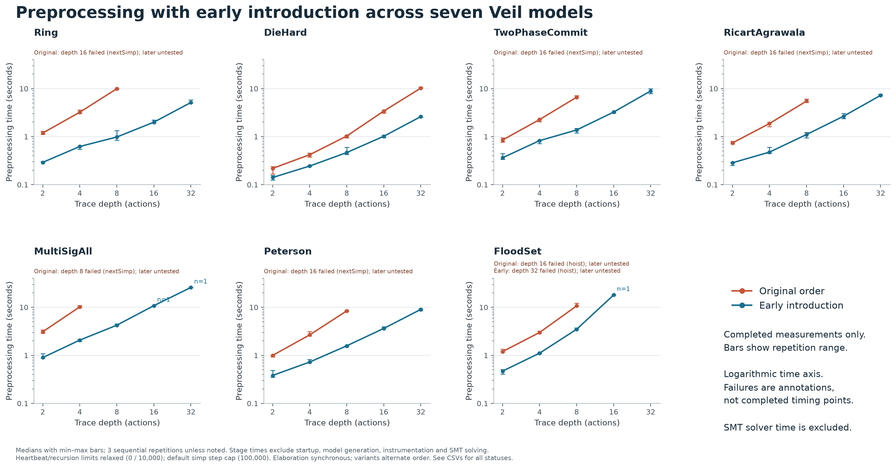

Scope correction: exploratory seven-model dataset

This earlier experiment used different selected assertions and raised heartbeat
and recursion limits. Its backend helper omitted the production compatibility
wrapper. Its explicit Veil-preprocessing timings remain useful exploratory
evidence, but its backend translation/solver measurements do not establish
production pipeline behavior and must not be merged with the comprehensive
49-file default-limit sweep. Use the sibling SymbolicBMC report (worktree) or
veil-symbolic-bmc/report/index.html (download package) for that comparison.
The new sweep includes the compatibility wrapper, withoutRecover and native
cvc5 plugin, and retains a frozen inventory and per-cell provenance.

# Early introduction for bounded SMT traces

This implements the first optimization investigated for [issue #123](https://github.com/verse-lab/veil/issues/123). The change is confined to the bounded-trace tactic, with semantic and depth regressions.

## What early introduction does

Before simplification, move the leading non-propositional binders into Lean's local context. For example, `⊢ ∀ s₀ … sₙ, ¬ Trace(s₀, …, sₙ)` becomes `s₀ … sₙ ⊢ ¬ Trace(s₀, …, sₙ)`. These are arbitrary fresh parameters. No constraints are dropped, and no universal/existential quantifiers are exchanged. The SMT refutation still searches for the same trace witnesses.

Stop before the first proof-valued binder. Its domain must remain available to the existing simplification and quantifier-hoisting passes. An unrestricted initial `veil_intros` was tested and rejected: it breaks a previously supported UNSAT trace whose header contains a disjunction of function-valued existentials. The conservative helper preserves that case, including a complete kernel-checked proof.

A proposition-valued typeclass instance also stops the prefix, so custom headers can retain some of the old cost.

The later `veil_intros` remains: normalization can expose additional binders. The existing genuine higher-order witness hoisting is retained. Naming follows `unhygienic intros`, preserving model reconstruction names.

## Why it helps

The old `veil_bmc` normalizes the whole universally quantified verification condition before introducing parameters. As the depth increases, simplification repeatedly traverses and reconstructs binder-dependent expressions and congruence proofs. An `any N actions` trace includes parameters for every action alternative at each step, making this prefix particularly large.

The guarded existential pass compounds the problem. Its higher-order test classifies structures as higher order, so the outer `State` and `Theory` binders can activate the expensive pass even without an internal function-valued witness. Removing those binders from the target avoids this false trigger. Real higher-order choices still require normalization and hoisting.

The historical example linked by the issue was unavailable during this investigation. The retained repository models reproduce the same simp-limit failure class and provide the before/after measurements.

The trace formula is already a conjunction of per-step action disjunctions. The immediate problem is repeated normalization of that formula under a long prefix, not enumeration of exponentially many action sequences.

## Validation

The final production `lake build VeilTest` passed all 1,226 jobs. Both new regression files pass, including the exact axiom checks and the depth-32 solver test. The axiom message guards ignore whitespace so line wrapping does not affect the check. Available validation evidence is in [validation/STATUS.txt](validation/STATUS.txt).

- `TraceEarlyIntroduction.lean`: trusted and untrusted SAT/UNSAT checks with a function-valued nondeterministic choice; a manual UNSAT proof; exact axiom checks excluding `sorryAx`; the quantified-proof-header regression.
- `DeepBmcTranslation.lean`: an actual depth-32 UNSAT solver check with two actions, two relations, and a framed Boolean. The old ordering exhausts simp's default 100,000-step budget. No production resource limit is raised.
- Existing exact model-name checks were also exercised with the conservative helper.
- Before/after SMT command comparisons and solver results are retained separately from translation measurements. SAT/UNSAT agreement is evidence; the semantic justification is the ordinary introduction rule and the existing proof-producing normalizations.

## Benchmark method

Seven repository examples are measured: Ring, DieHard, TwoPhaseCommit, RicartAgrawala, MultiSigAll, Peterson, and FloodSet. Depths are 2, 4, 8, 16, and 32. The explicit original and conservative early-introduction pipelines are embedded in the generated measurement sources, so the comparison does not depend on which tactic version is installed.

Each successful preprocessing cell has up to three sequential repetitions. Async theorem elaboration is disabled, and variant order alternates. Graphs report medians and observed ranges where available. Stage timings exclude Lean startup, model generation, instrumentation, and solver execution. A separate series includes lean-smt preparation and SMT-LIB serialization (one sample per cell). Failed or interrupted runs are not plotted as completed runtimes; deeper skipped cells are untested.

The benchmark uses `maxHeartbeats = 0` and `maxRecDepth = 10000` to isolate the unchanged default simp step limit. These overrides are only in the measurement scaffold. Scaffolds end with `sorry` and are not verification results; the regression tests and independent SMT runs supply correctness checks.

## Results and graphs



The following are medians of three completed preprocessing runs. Times exclude SMT solving. MultiSigAll uses depth 4 for the matched comparison because the original pipeline fails at depth 8.

| Model and individual graph | Comparison depth | Original | Early introduction | Speedup | Deepest completed early translation tested |
| --- | ---: | ---: | ---: | ---: | ---: |
| [Ring](figures/Ring-preprocessing.png) | 8 | 9.937 s | 0.981 s | 10.13× | 32 |
| [DieHard](figures/DieHard-preprocessing.png) | 8 | 1.027 s | 0.466 s | 2.20× | 32 |
| [TwoPhaseCommit](figures/TwoPhaseCommit-preprocessing.png) | 8 | 6.595 s | 1.374 s | 4.80× | 32 |
| [RicartAgrawala](figures/RicartAgrawala-preprocessing.png) | 8 | 5.486 s | 1.105 s | 4.96× | 32 |
| [MultiSigAll](figures/MultiSigAll-preprocessing.png) | 4 | 10.229 s | 2.078 s | 4.92× | 32 |
| [Peterson](figures/Peterson-preprocessing.png) | 8 | 8.417 s | 1.579 s | 5.33× | 32 |
| [FloodSet](figures/FloodSet-preprocessing.png) | 8 | 10.700 s | 3.492 s | 3.06× | 16 |

The original pipeline exhausts the default simp budget in `nextSimp` at depth 16 for Ring, TwoPhaseCommit, RicartAgrawala and Peterson, and at depth 8 for MultiSigAll. DieHard completes through depth 32 in both variants (10.229 s versus 2.609 s at depth 32). Deeper original cells after a failure are untested, not additional measured failures.

FloodSet isolates the remembered bottleneck: its original `nextSimp` completes at depth 16, then genuine existential hoisting exhausts the 100,000-step simp budget. Early introduction completes depth 16, but hoisting reaches the same cap at depth 32. Its completed depth-16 preprocessing takes 18.064 s, including 15.047 s of hoisting; downstream SMT preparation adds 24.385 s, including 23.837 s in embedding. These are two distinct remaining costs.

The main model-wide budget interrupted the MultiSigAll and FloodSet deeper cells. Fresh supplemental runs completed them separately. MultiSigAll depths 16/32 and FloodSet depth 16 therefore have one completed observation, explicitly marked `n=1`; other completed preprocessing cells have three. Failed/interrupted runs remain in the raw data and are not presented as completed runtimes.

Additional figures:

- [Measured stages through serialized SMT output](figures/overview-smt-output.png): preprocessing plus downstream translation/serialization, one sample per cell; excludes startup and solver execution.
- [Remaining stages at each model's deepest completed depth](figures/overview-remaining-phases.png): makes the remaining hoisting and SMT embedding costs visible.
- [Solver outcomes at matched depths 4 and 8](figures/overview-solver-outcomes.png): exact emitted queries replayed with a 10-second cap. All 12 pairs with definite responses agree; MultiSigAll depth 4 times out in both variants, and depth 8 has no original query and an early timeout. Single observations do not establish a solver speedup.
- [Preprocessing summary CSV](figures/summary.csv), [SMT output summary CSV](figures/smt-output.csv), [final solver CSV](final-solver/solver-results.csv), and [deepest-query feasibility CSV](deepest-solver/deepest-results.csv).

All 13 available old/early SMT query pairs at depths 4/8 match after command ordering and Boolean implication currying. This comparison does not rewrite the scripts submitted to the solver. Declaration order and equivalent expression shape can still affect heuristics. At the deepest completed early depths, all seven queries are accepted by cvc5; with a separate 2-second cap, TwoPhaseCommit32, RicartAgrawala32 and FloodSet16 return SAT, and the other four time out.

Every PNG has a matching SVG in `figures/`. Exact observations and methodology are retained in `combined/`, `results/`, `supplement-*`, `README.txt` and `SOLVER_README.txt`. The source revision, machine metadata and script hashes are recorded with the data.

## Remaining work

Early introduction removes an avoidable outer-prefix cost. It does not make solving easier in general, and it does not remove the cost of hoisting genuine nested function-valued witnesses. MultiSigAll exposes solver difficulty even after translation succeeds; FloodSet exercises genuine higher-order choices and downstream SMT preparation.

A next optimization worth investigating is component-wise hoisting: normalize separate transition conjuncts while preserving action disjunctions and exact equivalence. This needs bidirectional logical justification, nonempty-domain side conditions, and model-extraction checks. A source-to-target implication alone is insufficient for preserving SAT answers. The retained synthetic hoisting experiment studies this separately; its gains are not attributed to the implemented change.

Further candidates are reducing unused alternative-action parameters, sharing repeated normalized transition expressions, and improving the higher-order guard. Raising the simp budget merely moves the failure threshold. A global single-pass simp change was found to leave residual definitions that SMT translation cannot handle.

## Reproduce the measurements

From a checkout with Veil built:

```sh
python3 Benchmarks/SMTTranslation/EarlyIntroduction/benchmark.py --repo . --out-dir .veil.tmp/early-introduction-bench
python3 Benchmarks/SMTTranslation/EarlyIntroduction/plot.py --results .veil.tmp/early-introduction-bench --out-dir .veil.tmp/early-introduction-figures
```

The plotting script requires matplotlib. Use a fresh output directory to preserve the retained observations. Consult the runner's `--help` for selecting models, depths, repetition counts and budgets. The retained sources and raw logs establish exactly what was timed, including interrupted runs and any supplemental deep-cell measurements. Solver checks have a separate reproduction guide.
